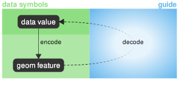
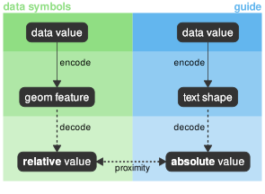
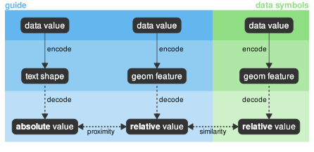
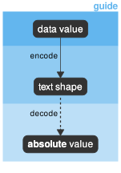
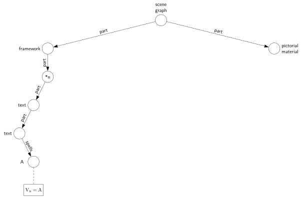

::: {.callout-note appearance="simple" icon=false collapse=false}
## Abstract {.unnumbered}

###### Introduction

A data visualisation can be described as an encoding of information
in the form of visual elements called data symbols.
The commonly-stated purpose of guides (axes and legends) is to allow
the viewer to decode information from the data symbols.
However, guides are themselves composed of visual elements.
This article addresses the following question:
If guides allow us to decode data symbols, what allows us to
decode guides?

###### Theory/model

Reasoning from an established understanding of how 
data visualisation perception works,
we propose that:  guides are also encodings of information,
just like data symbols;
information is decoded separately from both data symbols and 
from guides;
and information from data symbols and guides is combined 
via Gestalt principles such as proximity and similarity.

###### Conclusion

Given this understanding of how guides work, 
we revisit the design of standard guides, such
as axes and legends.
This leads to a novel x-axis design for quantitative length encodings
and an improved legend design 
for quantitative colour encodings.

:::


::: {.callout-note appearance="simple" icon=false collapse=true}
## Authorship, License, Conflicts

###### Authorship

AI tools were used to help identify resources, but the final text, images,
and underlying code contains no content that was generated by AI.

###### License

This work is licensed under a [Creative Commons Attribution 4.0 International License](http://creativecommons.org/licenses/by/4.0/).

© 2026 Copyright held by the owner/author(s).

###### Conflicts of interest

The author declares that there are no competing interests.

:::

## Introduction {#sec-introduction}

```{r}
#| echo: FALSE
knitr::opts_chunk$set(
    dev="svg"
)
```

```{r}
#| echo: FALSE
#| message: FALSE
library(knitr)
library(reshape2)
library(dplyr)
library(grid)
library(scales)
library(ggplot2)
library(gggrid)
library(colorspace)
library(bullseye)
```

```{r}
#| echo: FALSE
#| message: FALSE
trade <- subset(read.csv("trade-years.csv"), !(year %in% c(2014, 2025)))
tradeTotals <- aggregate(trade["amount"],
                         list(year=trade$year, 
                              account=trade$account, 
                              category=trade$category),
                         sum)
goods2024 <- subset(trade, 
                      year == 2024 & category == "Goods" & 
                      country != "Total all countries")
goods2024wide <- dcast(goods2024, year + country ~ account)
top10export <- 
    goods2024wide[order(goods2024wide$Exports, decreasing=TRUE)[1:10], ]
top10export$country <- 
    recode_values(top10export$country,
                  "China, People's Republic of" ~ "China",
                  "United States of America" ~ "USA",
                  "United Kingdom" ~ "UK",
                  "Korea, Republic of" ~ "Korea",
                  default = as.character(top10export$country))
top10export$country <- reorder(top10export$country,
                               top10export$Exports,
                               max)
top10 <- melt(top10export, id.vars=c("year", "country"), 
              variable.name="account", value.name="amount")
top10$account <- factor(top10$account, levels=c("Imports", "Exports"))
```

@fig-trade-bars shows the amount of goods, 
in billions of dollars,
that were traded between New Zealand and its largest trade partners
in 2024.\footnote{Stats New Zealand Overseas Merchandise Trade Datasets
\url{https://www.stats.govt.nz/large-datasets/csv-files-for-download/overseas-merchandise-trade-datasets/}.}
This plot can be broken down into several standard components: data symbols
(the bars), a title, an x-axis, a y-axis, and a legend.

```{r}
#| label: fig-trade-bars
#| echo: FALSE
#| fig-keep: last
#| fig-cap: "A bar plot of international trade between New Zealand and its major partners in 2024."
#| fig-alt: "A bar plot of international trade between New Zealand and its major partners in 2024. There are two bars per country, one for imports and one for exports. The purpose of this plot is just to show a standard example of plot components: data symbols (bars), axes, legend, and title."
ggBar <- function(data=top10) {
    ggplot(data) +
    geom_col(aes(amount, country, fill=account), position="dodge") +
    scale_x_continuous(expand=expansion(c(0, .05)),
                       breaks=1e9*seq(0, 15, 5),
                       labels=paste(seq(0, 15, 5), c("", "", "", "$billion"))) +
    scale_fill_discrete(name=NULL) +
    labs(title="Top 10 New Zealand Trade Partners in 2024", x=NULL, y=NULL) +
    theme(aspect.ratio=1, plot.margin=margin(0, 0, 0, 0),
          plot.background=element_blank(),
          panel.background=element_blank(),
          panel.grid.minor=element_blank(),
          panel.grid.major.y=element_blank(),
          panel.grid.major.x=element_line(colour="grey", linewidth=.1),
          axis.ticks=element_blank(),
          axis.text.x=element_text(hjust=0),
          legend.text=element_text(colour="black"))
}
margin <- unit(30, "mm")
grid.rect(gp=gpar(col="grey"))
pushViewport(viewport(width=unit(1, "npc") - margin,
                      height=unit(1, "npc") - margin,))
print(ggBar(), newpage=FALSE)
grid.force()
legend <- grid.get("guide-box-right", grep=TRUE)
```

The axes, the legend, and even the title, are collectively known as *guides*
[@wilkinson2005grammar] because they 
share a common purpose:  they explain how data values are encoded
within the plot.
The guides are there to help us to decode the data symbols.
For example, in @fig-trade-bars, the trade account, imports 
versus exports, is encoded as the colour of the bar data symbols.
However, bars that differ in colour only indicate that there
are different groups---salmon 
is different from turquoise.
The legend is necessary to explain *which* group corresponds to each 
colour---salmon means imports and turquoise means exports.

We have an understanding
of how data symbols work.
For example, we know that encoding trade amounts as the lengths of
bars will result in an accurate decoding of their relative lengths,
particularly when they share a common baseline
[@cleveland1984graphical; @mackinlay1986automatic; @heer2010crowdsourcing].
We know *why* bars are effective data symbols and this helps us
to make deliberate choices about which data symbols to use
when encoding information.

However, we lack corresponding explanations for how guides work.  The *purpose*
of guides is often stated in data visualisation guidelines---"helping the user
understand and interpret the data in your chart" [@ONS-service-manual-dataviz]
and
"allow readers to decode the graphic" [@heer-scales-axes-legends]---but the
mechanism by which guides achieve their purpose is more mysterious (see
@fig-guide-myth).  For example, there is almost no mention of axes and legends
in the detailed data visualisation framework described in
@munzner2014visualization.

```{r}
#| label: fig-guide-myth
#| echo: FALSE
#| out-width: 4.1in
#| fig.cap: It is commonly agreed that the data symbols in a data visualisation arise from encoding information as the visual features of geometric shapes and the purpose of a guide is to allow us to decode that information. However, the mechanism by which the guide allows that decoding to happen is a little hazy.
#| fig-alt: A node-and-edge diagram with two columns. The left column represents data symbols, with a line indicating that data values are encoded as visual features of geometric shapes. The right column represents guides and a dashed line that fades out in the middle indicates that guides allow us to decode back from visual features to data values, though exactly how that happens is unclear.

```

The goal of this article is to consider how guides work
in greater depth---to form a better understanding of what makes an effective 
guide.
As a result, we hope to 
encourage a more intentional and reasoned use of guides
in data visualisation.
Rather than relying on dogmatic rules of thumb, such as "always label your axes"
[@xkcd833], we would like to arm ourselves with 
the means to justify our choice of guides.
We will also demonstrate that a deeper understanding of guides
makes it possible to question the design of
even very standard and established guides.

## Guides are encodings too {#sec-encodings}

We are familiar with the idea that data symbols are the result 
of encoding data values as the visual features
of geometric shapes 
[@bertin1983semiology; @munzner2014visualization].
For example, in @fig-trade-bars, the bars are the result of
encoding country names as the vertical positions
of rectangles and encoding trade amounts as the lengths of the rectangles;
the bars for China are above the bars for USA and the
bars for China are longer because New Zealand has more trade with China.

We are also familiar with the idea that some encodings are
more effective than others.
For example, encoding quantitative data values, like trade amounts,
as the length of bars is
effective because we can accurately decode the relative lengths
to determine how much larger one trade amount is compared to another
[@cleveland1984graphical].
In @fig-trade-bars
we can see that the export trade for China is about
twice the export trade for USA. 
Furthermore, encoding qualitative data values, such as countries, as 
the positions of bars is effective because we can easily
decode differences in position
[@munzner2014visualization].
We can easily see that the bars for China are
qualitatively different from the bars for USA,
based on their different vertical positions.

It is less common to think of *guides* as the result of encodings,
or to think about the effectiveness of guides in terms of 
their encodings,
but that is what we will do in this section.
First of all, we will consider
the y-axis in @fig-trade-bars
and point out some similarities with the data symbols
(the bars) in @fig-trade-bars.

Although the y-axis consists of text labels and the bars
consist of rectangles, they both result from 
encoding country names as vertical positions.
The bars for China are above the bars for USA
and the label for China is above the label for USA.

Furthermore, just as we can easily decode qualitative differences 
from the vertical positions of the bars, we can easily
decode qualitative differences from the vertical positions of the labels
[@brath2020visualizing].
The China bars represent a different group from the USA bars
and the China label represents a different group from the USA label.

One difference between the y-axis and the bars in @fig-trade-bars
is that the y-axis is *also* the result of
encoding country names as the *shape* of the text labels.
The label for China is in a different vertical position
than the label for USA *and* the label for China
uses different letters than the label for USA.
The label shapes mean that, in addition to being able to decode that the labels
are different, we can decode the absolute data values themselves:
China and USA [@Murrell_2026].

In summary, the y-axis is very similar to the bars in 
@fig-trade-bars because the y-axis encodes the same
data values as the bars, uses the same encoding as the 
bars---vertical position---and
we can decode the same information from the y-axis as we can from the 
bars---that there are different qualitative data values.
The difference is that the y-axis also encodes the data values
as text shape so we can also decode the absolute qualitative data values---the
country names---from the text shapes (see @fig-text-guide).

```{r}
#| label: fig-text-guide
#| echo: FALSE
#| out-width: 4.1in
#| fig.cap: The simplest sort of guide consists only of text labels, like the y-axis in @fig-trade-bars.  Data values are encoded as the shape of text labels just as data values are encoded as the visual features of data symbols. The difference is that absolute values can be decoded from text labels, whereas only relative values can be decoded from data symbols.  A value decoded from the text label is associated with a data symbol, and values decoded from the data symbol, through the proximity of the text label to the data symbol.
#| fig-alt: A node-and-edge diagram with two columns. The left column represents data symbols, with a line indicating that data values are encoded as visual features of geometric shapes and a dashed line indicating that relative values are decoded from the visual features of geometric shapes. The right column represents guides with a line indicating that data values are encoded as the shape of text and absolute values are decoded from text shape. A dotted line indicates that the relative value from the data symbols is associated with the absolute value from the guide thanks to the proximity of the guide text to the data symbol.

```

In this sense, the y-axis guide is just like the bar data symbols
because they both result from encoding data values as visual features and we 
decode information from those visual features.
On their own, the bars and the y-axis work in very similar ways.

The final piece of the puzzle---how the y-axis is used to explain the
bars---depends on the fact that the y-axis text labels
are placed right next to the corresponding data symbol bars
[@wagemans2012gestalt].
This *proximity* means that we can associate the information that we decode
from the text labels---the country names---with the associated bars
(see @fig-text-guide).
For example, the topmost bars are associated with the country China
because the text label "China" is placed right next to the topmost bars.

### Annotations

@fig-trade-bars-annotation
shows a variation on @fig-trade-bars,
with an *annotation* added.
This is another sort of guide that consists of
a label to describe a
point of interest.
In this case, the point is that the United Kingdom,
New Zealand's largest trade partner a century ago, is a much smaller trade
partner (in relative terms) in the present day.

```{r}
#| label: fig-trade-bars-annotation
#| echo: FALSE
#| fig-keep: last
#| fig-cap: "A bar plot of international trade between New Zealand and its major partners in 2024 with an annotation indicating New Zealand's largest trading partner in 1924."
#| fig-alt: "The bar plot from @fig-trade-bars with an annotation added: a text label with a line from the text to the bars for the UK.  The purpose of this plot is just to demonstrate an example of an annotation guide."
ann <- function(data, coords) {
    i <- which(data$y == 4)[2]
    lab <- textGrob("largest trade partner in 1924",
                    x=.5, y=.2, hjust=0,
                    gp=gpar(lineheight=.9))
    curve <- curveGrob(unit(.5, "npc") - unit(1, "mm"), .2, 
                       unit(coords$x[i], "npc") + unit(1, "mm"),
                       coords$y[i], inflect=TRUE,
                       curvature=-1,
                       arrow=arrow(angle=15, length=unit(2, "mm"), 
                                   type="closed"),
                       gp=gpar(fill="black"))
    grobTree(lab, curve)
}
ggAnn <- ggBar() +
    grid_panel(ann, aes(amount, country)) +
    coord_cartesian(clip="off")
grid.rect(gp=gpar(col="grey"))
pushViewport(viewport(width=unit(1, "npc") - margin,
                      height=unit(1, "npc") - margin,))
print(ggAnn, newpage=FALSE)
grid.force()
legend <- grid.get("guide-box-right", grep=TRUE)
```

We can explain the effectiveness of the annotation in 
@fig-trade-bars-annotation
using the same approach that we used to explain the y-axis.

The annotation label is an encoding of information as the shape of text and
we can decode absolute information from that text.
This information is associated with the United Kingdom by Gestalt
grouping, in this case not by proximity, but
by *connection*;  there is a line drawn between the position of 
the annotation label
and the position of the data symbols for the United Kingdom.

## Guides are data symbols too {#sec-geoms}

We will now consider the legend in @fig-trade-bars in a 
somewhat unconventional way.
For a start, we will consider the legend in isolation, as shown below.

```{r}
#| echo: FALSE
#| fig-width: 2
#| fig-height: 1
#| out-width: 25%
grid.newpage()
grid.draw(legend)
```

This legend consists of two coloured rectangles with a label alongside each 
rectangle.
The vertical positions of the rectangles and the vertical positions
of the labels encode different
trade accounts: Imports and Exports.
In addition, the trade accounts are encoded as the shapes of the 
text labels.
Furthermore, the trade account is encoded as the colour of the 
rectangles: salmon for the Imports rectangle and turquoise for the
Exports rectangle.

We can decode qualitative differences from the vertical positions 
and the colours of the
rectangles, and we can decode qualitative differences 
from the vertical positions of 
the labels, *and* we can decode absolute trade accounts from
the shapes of the text labels.
The proximity of the labels to the rectangles allows us to associate a specific 
trade account with each rectangle and therefore with each colour.

That description of the legend sounds a lot like the description of the
bar data symbols and the y-axis in @fig-trade-bars because the 
legend, in isolation, works the same way.
There are text labels that tell us which group each bar 
(and each colour) corresponds to.

So one point we can make is that 
the legend is a mini data visualisation all by itself.
It consists not only of text labels, but also geometric shapes (rectangles)
just like data symbols.
A second point is that a guide can consist just of text labels,
like the y-axis, or it can consist of text labels plus geometric shapes,
like the legend.

Of course, the legend is not intended to be used in isolation.
We need to associate the information from the legend with the bar
data symbols.
The information that we decode from the legend can be associated with
the bar data symbols through Gestalt grouping again,
in this case via the *similarity* of the colours 
[@wagemans2012gestalt];
the bar data symbols for Exports are the same colour as the rectangles
for Exports in the legend.

In other words, the legend works by associating text labels with
geometric shapes in the legend (by proximity) and then associating the geometric
shapes in the legend with geometric shapes in the plot (by similarity; 
see @fig-text-geom-guide).

```{r}
#| label: fig-text-geom-guide
#| echo: FALSE
#| out-width: 6.2in
#| fig.cap: A guide may contain geometric shapes as well as text labels, for example, the legend in @fig-trade-bars.  Data values are encoded as visual features of geometric shapes in the legend just like they are for data symbols. Values decoded from the shapes in a legend, or from text labels associated with those shapes, are associated with the values decoded from data symbols, through the similarity of the shapes in the legend and the shapes in the data symbols.
#| fig-alt: A node-and-edge diagram with three columns. The left column represents data symbols, with a line indicating that data values are encoded as visual features of geometric shapes and a dashed line indicating that relative values are decoded from the visual features of geometric shapes. The right two columns represent guides, with the middle column repeating the left column, to indicate that geometric shapes in guides work the same as geometric shapes in data symbols, and, in the right column, a line indicating that data values are encoded as the shape of text and absolute values are decoded from text shape. A dotted line indicates that the relative value from the geometric shape in the guide is associated with the absolute value from the text in the guide thanks to the proximity of the text to the geometric shape *and* another dotted line to indicate that the information from the guide is associated with the relative value from the data symbols thanks to the similarity of the geometric shape in the guide to the geometric shape of the data symbol.

```

### Improving a legend

We have identified that the legend in 
@fig-trade-bars works thanks to Gestalt similarity.
The bar data symbols are automatically associated with the 
rectangles in the legend that have the same colour.
However, that grouping by similar colours
is most effective when the shapes being compared are otherwise 
the same 
*and* when there is less complexity overall
[@carpenter1998model; @Yu09082015; @YU20198].

This leads to the conclusion that we should make the geometric shapes
in the legend as similar as possible to the geometric shapes in the
data symbols.

On one hand, this is an unsurprising result.
The purpose of a guide is to explain or demonstrate the encoding
of data symbols, so the encoding of geometric shapes
in the guide should match the encoding of geometric shapes in the data symbols.
This is what the legend in @fig-trade-bars does:
the encoding of rectangle colour in the legend matches the
encoding of rectangle colour in the data symbols.

However, a more strict interpretation
says that there should be encodings within a guide that match
the encodings used for data symbols *and there should be no other encodings*.
Furthermore, a strict interpretation of "no other encodings" 
includes implicit or unintentional encodings---visual differences
that are noticeable even though they have no explicit connection to
differences in the data [@wolfe-horowitz].

Given this strict interpretation,
the legend in @fig-trade-bars is deficient because,
although the rectangles in the legend encode 
colour in the same way as the rectangles for the bar data symbols, 
the rectangles in the legend differ from the bar rectangles in the several 
visually-significant ways.

@fig-trade-bars-legend shows a variation
of @fig-trade-bars with a legend that attempts to
satisfy the strict interpretation.
The rectangles in the legend are now the same height as the bar rectangles,
the rectangles in the legend start at the same horizontal position as the bar 
rectangles, there is no vertical separation between the rectangles in the
legend (just like the bar rectangles), and
the rectangles in the legend are in the
same vertical order as the bar rectangles (with exports on top).
The comparison between the geometric shapes of the data symbols
and geometric shapes in the guide is now a case of like versus like.
The encodings in the legend match the encodings in the data symbols
and there are no other visual differences between the geometric shapes
in the legend and the geometric shapes of the data symbols.
The legend in @fig-trade-bars-legend
may not provide a very large improvement over the legend in
@fig-trade-bars,
but it does demonstrate how we can deliberately apply a deeper
understanding of how guides work.

```{r}
#| label: fig-trade-bars-legend
#| echo: FALSE
#| results: hide
#| fig.keep: last
#| fig.cap: The bar plot from @fig-trade-bars, but with a non-standard legend. The geometric shapes in this legend match the geometric shapes of the data symbols much more closely.
#| fig-alt: The bar plot from @fig-trade-bars, but with a non-standard legend. The geometric shapes in this legend match the geometric shapes of the data symbols much more closely. Specifically, the bars in the guide have the same height, the same horizontal baseline, and the same vertical order as the data symbol bars.
ggBarLegend <- ggBar() +
    coord_cartesian(clip="off") +
    theme(legend.text=element_text(colour="white"))
grid.newpage()
grid.rect(gp=gpar(col="grey"))
pushViewport(viewport(width=unit(1, "npc") - margin,
                      height=unit(1, "npc") - margin,
                      y=.55))
print(ggBarLegend, newpage=FALSE)
upViewport()
grid.force()
barsPath <- grid.grep("panel-1::geom_rect", grep=TRUE, viewports=TRUE)
bars <- grid.get(barsPath)
downViewport(attr(barsPath, "vpPath"))
barSize <- convertHeight(bars$height[1], "in")
barGap <- convertHeight(bars$y[1] - bars$y[2], "in")
## Old legend
keyPaths <- grid.grep("guides::layout::key::gTree::rect", 
                      grep=TRUE, global=TRUE)
sapply(keyPaths, grid.edit, gp=gpar(fill=NA))
## New legend
cols <- pal_hue()(2)
edge <- 1
newLegend <- function(gap=.7) {
    x <- unit(0, "npc")
    y <- unit(0, "npc") - unit(gap, "in") + unit(edge, "mm") + bars$height[1]
    accountText <- textGrob(rev(levels(top10$account)),
                         unit(-1.5, "mm"),
                         y + c(.6, -.6)*barSize,
                         hjust=1,
                         gp=gpar(fontsize=8, col="#4D4D4DFF"))
    grid.draw(accountText)
    grid.segments(x, 
                  y + barSize + unit(edge, "mm"),
                  x,
                  y - barSize - unit(edge, "mm"),
                  gp=gpar(col="grey"))
    grid.segments(x, 
                  y,
                  x - unit(1, "mm"),
                  y,
                  gp=gpar(col="grey"))
    grid.rect(x, y,
              width=2*barSize,
              height=rep(barSize, 2),
              hjust=0,
              vjust=1:0,
              gp=gpar(col=NA, fill=cols))
}
newLegend()
```

### Direct labelling

We have established that a legend works
by associating text labels with geometric shapes
and then by associating geometric shapes in the
legend with the geometric shapes of the data symbols.
In other words, a legend works in two steps: the first step
just uses the proximity of text labels to geometric shapes;
and the second step uses the similarity of geometric shapes
(see @fig-text-geom-guide).

@fig-trade-bars-legend was an attempt to improve
@fig-trade-bars by optimising
the second step---by optimising the similarity of the
geometric shapes that are used in the legend and for the data symbols.
An alternative approach to improving @fig-trade-bars
is just to remove the second step altogether.

@fig-trade-bars-direct moves the
text labels from the legend to positions directly beside the top two bars.
The trade account is encoded as the vertical position of the text labels
(for one country, China) and as the shape of the text labels.
These two labels act as a guide for the encoding
of trade account that works
in a similar way to the y-axis labels.
We can decode the exact data values for trade account from the labels
and rely on the encoding of vertical position of the labels,
plus Gestalt proximity, to
group a bar with its corresponding label
(see @fig-text-guide).
There is no longer any need to compare a geometric shape in the guide with
the geometric shapes of the data symbols [@carpenter1998model].
This approach is sometimes called *direct labelling* [@tufte2006beautiful].

In @fig-trade-bars-direct, we have also encoded the 
trade account as the colour of the text labels.  This further
reinforces the association between the text labels and the
relevant bars for China, plus it visually groups the labels with bars of
similar colour across the whole plot.

It is worth noting that, according to this breakdown, 
a standard y-axis, like the one in @fig-trade-bars,
is actually just a form of direct labelling.

```{r}
#| label: fig-trade-bars-direct
#| echo: FALSE
#| fig.keep: last
#| results: hide
#| fig.cap: The bar plot from @fig-trade-bars, but instead of a legend, direct labelling is used to explain the encoding of trade account by placing text labels adjacent to the associated data symbols (proximity), plus colour to associate with other data symbols (similarity).
#| fig-alt: The bar plot from @fig-trade-bars, but instead of a legend, direct labelling is used to explain the encoding of trade account by placing text labels adjacent to the associated data symbols (proximity), plus colour to associate with other data symbols (similarity).
directLabel1 <- function(prefix="  ") {
    annotate("text", label=paste0(prefix, "Exports"), 
             size=8, size.unit="pt", fontface="bold",
             x=top10$amount[top10$country == "China" & 
                            top10$account == "Exports"], 
             y="China", hjust=0, vjust=-.5, colour=cols[2])
}
directLabel2 <- function(prefix="  ") {
    annotate("text", label=paste0(prefix, "Imports"), 
             size=8, size.unit="pt", fontface="bold",
             x=top10$amount[top10$country == "China" & 
                            top10$account == "Imports"], 
             y="China", hjust=0, vjust=1.5, colour=cols[1])
}
ggBarLegend <- ggBar() +
    coord_cartesian(clip="off") +
    theme(legend.text=element_text(colour="white")) +
    directLabel1() + directLabel2()
grid.newpage()
grid.rect(gp=gpar(col="grey"))
pushViewport(viewport(width=unit(1, "npc") - margin,
                      height=unit(1, "npc") - margin,
                      y=.5))
print(ggBarLegend, newpage=FALSE)
upViewport()
grid.force()
## Old legend
keyPaths <- grid.grep("guides::layout::key::gTree::rect", 
                      grep=TRUE, global=TRUE)
sapply(keyPaths, grid.edit, gp=gpar(fill=NA), redraw=FALSE)
grid.refresh()
```

### Improving an x-axis

We now move on to the x-axis in @fig-trade-bars.
On one hand, the x-axis can be analysed in a similar fashion to the y-axis.
The bar data symbols are a result of encoding trade amounts
as horizontal bar lengths and the x-axis is a result of encoding trade amounts
as the horizontal position of text labels.
In addition, trade amounts are encoded as the shape of the text labels
on the x-axis.

We can decode quantitative differences from the bar lengths.
We can easily see that some bars are longer than others and 
we can also decode the ratios of bar lengths, for example,
the China export bar is roughly twice the length of the USA export bar.
We can decode similar quantitative information from the positions
of the text labels.  In fact, ratios are even easier to decode
because of the regular spacing of the text labels.
Finally, we can decode absolute trade amounts from the shapes of the
text labels.

However, there are several differences between the y-axis and the x-axis
in @fig-trade-bars.
Whereas both axes contain text labels, the 
x-axis also consists of vertical grid lines.
In this sense, the x-axis is similar to the legend
because it contains both text labels and geometric shapes.

We can associate the trade amounts from the x-axis labels with
the grid lines due to their proximity to each other 
(just as we associate labels with rectangles in the legend) and we
can compare the lengths of the bar data symbols to the grid lines
to associate bar length differences and ratios with actual trade amounts.
The latter step is similar to the second step in how a legend works
because it involves comparing geometric shapes, even if
in this case it is comparing lengths for differences rather than
comparing colours for similarity as in the legend
(see @fig-text-geom-guide).

The main point is that the x-axis works in two steps, like the legend,
which means that we can modify the x-axis using 
the same idea that we used to modify 
the legend in @fig-trade-bars-legend.
Specifically, we can
make the geometric shapes in the x-axis as similar as possible
to the geometric shapes used for the data symbols, except for
the encoded differences.

@fig-trade-bars-x-axis
implements that approach for the bar plot in @fig-trade-bars-direct.
In @fig-trade-bars-x-axis, the x-axis
consists of the same labels as before, but
the geometric shapes on the x-axis are now rectangles.
Now, the encoding of the geometric shapes in the guide (lengths of rectangles) 
matches the encoding
of the geometric shapes used for the data symbols (also lengths of rectangles).
Furthermore, in addition to the obvious choice of aligning the
left edge of the rectangles in the guide with the left edge of the rectangle
data symbols, we have set the heights of the rectangles in the guide
to be the same as the heights of the rectangle data symbols.
In summary, we are now able to compare the lengths of bar data symbols with 
the lengths of bars in the x-axis, 
rather than comparing the lengths of bar data symbols with the positions
of grid lines in the x-axis.

We should acknowledge that there *is* a significant visual difference between
the x-axis bars and the data symbol bars 
in @fig-trade-bars-x-axis because the x-axis
bars are grey whereas the data symbol bars are teal or salmon.
This difference is necessary in order to differentiate the bars for the
x-axis from the bars for the data symbols.
In effect, the use of grey versus teal/salmon encodes the categorical
information that some bars are for the x-axis and some bars are
data symbols.

```{r}
#| label: fig-trade-bars-x-axis
#| echo: FALSE
#| fig.keep: last
#| results: hide
#| fig.cap: The bar plot from @fig-trade-bars, but with a non-standard x-axis that explains the encoding of trade amount using the lengths of bars.  The geometric shapes in this axis provide a better match of the encoding used for the data symbols.
#| fig-alt: The bar plot from @fig-trade-bars, but with a non-standard x-axis that consists of bars rather than vertical grid lines.  The geometric shapes in this axis provide a better match of the encoding used for the data symbols.
exemplars <- seq(5, 15, 5)
xaxis <- function(data, coords) {
    y <- unit(-1, "mm") - barSize - (0:2)*(barGap - barSize)
    grobTree(rectGrob(0, y, width=coords$x, height=barSize, 
                      hjust=0, vjust=.5,
                      gp=gpar(col=NA, fill="grey80")),
             textGrob(paste(unique(data$label), c("", "", "$billion")),
                      unit(unique(coords$x), "npc") + unit(1, "mm"), 
                      y, just="left",
                      gp=gpar(fontsize=8)))
}
ggBarAxis <- ggBar() +
    coord_cartesian(clip="off") +
    theme(legend.text=element_text(colour="white"),
          ## Old axis
          panel.grid.major.x=element_blank(),
          axis.ticks.x=element_line(colour=NA),
          axis.text.x=element_text(colour=NA),
          axis.title.x=element_text(colour=NA)) +
    directLabel1() + directLabel2() +
    ## New axis
    grid_panel(xaxis, aes(amount, label=label), 
               data=data.frame(amount=1e9*exemplars, label=exemplars))
grid.newpage()
grid.rect(gp=gpar(col="grey"))
pushViewport(viewport(width=unit(1, "npc") - margin,
                      height=unit(1, "npc") - margin,
                      y=.55))
print(ggBarAxis, newpage=FALSE)
upViewport()
grid.force()
barsPath <- grid.grep("panel-1::geom_rect", grep=TRUE, viewports=TRUE)
bars <- grid.get(barsPath)
downViewport(attr(barsPath, "vpPath"))
## Old legend
keyPaths <- grid.grep("guides::layout::key::gTree::rect", 
                      grep=TRUE, global=TRUE)
sapply(keyPaths, grid.edit, gp=gpar(fill=NA), redraw=FALSE)
grid.refresh()
```

One problem with @fig-trade-bars-x-axis is that it is more
difficult to compare the rectangles in the data symbols with the rectangles in
the x-axis thanks to the vertical distance between the rectangles
[@lu2021modeling; @talbot2014four].
@fig-trade-bars-x-axis-embedded applies a further
modification, abandoning the traditional position of the x-axis
at the bottom of the plot and placing the guide rectangles amongst
the ordered rectangles used for the data symbols.

```{r}
#| label: fig-trade-bars-x-axis-embedded
#| echo: FALSE
#| fig.keep: last
#| results: hide
#| message: FALSE
#| fig.cap: The bar plot from @fig-trade-bars-x-axis, but with the x-axis is embedded alongside the data symbols to make length comparisons easier and more accurate.
#| fig-alt: The bar plot from @fig-trade-bars-x-axis, but with the x-axis bars embedded alongside the data symbols to make length comparisons easier and more accurate. For example, the x-axis bar that represents 5 billion dollars is in between the bars for Australia (imports and exports more than 5 billion dollars) and the bars for Japan (imports and exports less than 5 billion dollars).
top10xaxis <- rbind(top10, 
                    data.frame(year=2024, 
                               country=as.character(exemplars),
                               account=rep(c("Exports", "Imports"), 3),
                               amount=1e9*exemplars))
top10xaxisWide <- dcast(top10xaxis, year + country ~ account)
top10xaxisWide <- 
    top10xaxisWide[order(top10xaxisWide$Exports, decreasing=TRUE), ]
top10xaxisWide$country <- factor(top10xaxisWide$country,
                                 levels=rev(top10xaxisWide$country))
top10xaxis <- melt(top10xaxisWide, id.vars=c("year", "country"), 
                   variable.name="account", value.name="amount")
top10xaxis$amount[top10xaxis$country %in% as.character(exemplars)] <- 0
internalBars <- function(data, coords) {
    grobTree(rectGrob(0, coords$y, width=coords$x, height=barSize2, 
                      hjust=0, vjust=c(.5, 0, 1),
                      gp=gpar(col=NA, fill="grey80")),
             textGrob(paste(unique(data$label), c("", "", "$billion")),
                      unit(unique(coords$x), "npc") + unit(1, "mm"), 
                      unique(coords$y), hjust=0, vjust=c(.5, 0, 1),
                      gp=gpar(fontsize=8)))             
}
ggBarAxis2 <- ggBar(top10xaxis) +
    coord_cartesian(clip="off") +
    geom_col(aes(amount, country, fill=account), position="dodge") +
    scale_y_discrete(labels=function(x) {
                                x[x %in% as.character(exemplars)] <- ""
                                x
                            }) +
    theme(legend.text=element_text(colour="white"),
          ## Old axis
          panel.grid.major.x=element_blank(),
          axis.ticks.x=element_line(colour=NA),
          axis.text.x=element_text(colour=NA),
          axis.title.x=element_text(colour=NA)) +
    directLabel1() + directLabel2() +
    ## New grid lines
    grid_panel(internalBars, aes(amount, label, label=label),
               data=data.frame(label=as.character(exemplars),
                               amount=1e9*exemplars)) +
    ## Give some more height to allow for "axis" bars
    theme(aspect.ratio=1.3)
## Draw once to get new 'barSize'
barSize2 <- barSize
grid.newpage()
pushViewport(viewport(width=unit(1, "npc") - margin + unit(10, "mm"),
                      height=unit(1, "npc") - margin + unit(10, "mm"),
                      y=.5))
print(ggBarAxis2, newpage=FALSE)
upViewport()
grid.force()
barsPath <- grid.grep("panel-1::geom_rect", grep=TRUE, viewports=TRUE)
bars <- grid.get(barsPath)
downViewport(attr(barsPath, "vpPath"))
barSize2 <- convertHeight(bars$height[1], "in")
## Draw again with added bars
grid.newpage()
grid.rect(gp=gpar(col="grey"))
pushViewport(viewport(width=unit(1, "npc") - margin + unit(10, "mm"),
                      height=unit(1, "npc") - margin + unit(10, "mm"),
                      y=.5))
print(ggBarAxis2, newpage=FALSE)
upViewport()
grid.force()
## Old legend
keyPaths <- grid.grep("guides::layout::key::gTree::rect", 
                      grep=TRUE, global=TRUE)
sapply(keyPaths, grid.edit, gp=gpar(fill=NA), redraw=FALSE)
grid.refresh()
```

In @fig-trade-bars-x-axis-embedded, compared to 
@fig-trade-bars,
our analysis of how guides work has essentially lead us to 
replace the original legend with a second y-axis and
to replace the original x-axis with a new (embedded) legend.
Again, it is difficult to claim that @fig-trade-bars-x-axis-embedded
is in all ways superior to @fig-trade-bars, but 
@fig-trade-bars-x-axis-embedded does demonstrate that 
a deeper understanding of how guides work
can lead us to consider some novel approaches
to generating guides.

Another reason why the standard x-axis works in @fig-trade-bars
is because viewers are very used to seeing a guide like this
in a data visualisation [@tsai2026pictorial].
@fig-trade-bars-x-axis-embedded is at a disadvantage in this regard
because viewers are not used to seeing an embedded x-axis.

Before we leave the x-axis, we must acknowledge the alternative approach
that we used to improve the legend in @fig-trade-bars-direct:
instead of attempting to improve the second step,
we can just remove the second step by using direct labelling.

@fig-trade-bars-x-axis-direct
shows a version of our bar plot with all trade amounts
encoded as text labels directly beside each bar.
Although we are now able to decode trade amounts from the shape of text labels 
and associate those trade amounts with bars simply by the proximity
of the text labels to the bars,
the large number of text labels makes it more difficult to
compare the bars themselves.
@fig-trade-bars-x-axis-direct
demonstrates that direct labelling is not always a good option,
essentially due to the clutter that it creates
[@show-or-tell; @ajani2021declutter].
In essence, an important limitation of direct labelling is that it 
becomes impossible to place multiple labels directly next to the 
related data symbol (and *not* too close to unrelated data symbols).

```{r}
#| label: fig-trade-bars-x-axis-direct
#| echo: FALSE
#| fig.keep: last
#| results: hide
#| fig.cap: The bar plot from @fig-trade-bars, but instead of an x-axis, direct labelling explains the encoding of trade amounts by placing labels adjacent to the associated data symbols (proximity).
#| fig-alt: The bar plot from @fig-trade-bars, but instead of an x-axis, direct labelling explains the encoding of trade amounts by placing labels at the ends of the associated bars (proximity).
ggBarAxisDirect <- ggBar() +
    geom_text(aes(amount, country, 
                  label=ifelse(amount/1e9 < 10, 
                               sprintf(" %.1f", amount/1e9), 
                               sprintf(" %.0f", amount/1e9))),
              vjust=rep(c(-.5, 1.5), each=nrow(top10)/2), hjust=0,
              size=8, size.unit="pt") +
    coord_cartesian(clip="off") +
    theme(legend.text=element_text(colour="white"),
          panel.grid.major.x=element_blank(),
          axis.text.x=element_text(colour="white"),
          axis.title.x=element_text(vjust=-1)) +
    directLabel1("        ") + directLabel2("        ")
grid.newpage()
grid.rect(gp=gpar(col="grey"))
pushViewport(viewport(width=unit(1, "npc") - margin,
                      height=unit(1, "npc") - margin,
                      y=.5))
print(ggBarAxisDirect, newpage=FALSE)
upViewport()
grid.force()
## Old legend
keyPaths <- grid.grep("guides::layout::key::gTree::rect", 
                      grep=TRUE, global=TRUE)
sapply(keyPaths, grid.edit, gp=gpar(fill=NA), redraw=FALSE)
grid.refresh()
dev.off()
```

### Improving a quantitative colour legend

We now turn to a new example in order to demonstrate another common
type of guide.
@fig-corr-mats-penguin shows
a correlation matrix for variables measured on 
Penguins in the Palmer Archipelago, Antarctica 
(the Palmer Penguins data set).\footnote{Available as 
the data frame \code{penguins} in \proglang{R}.}
Correlations are either Pearson's *r* (for pairs of quantitative variables)
or canonical correlation 
[if either variable is qualitative, 
@chinwan2025tidydatastructurevisualisations]
and the data symbols in this plot are circles, one for each correlation.

```{r}
#| label: fig-corr-mats-penguin
#| echo: FALSE
#| fig.keep: last
#| results: hide
#| message: FALSE
#| fig.cap: Correlations between variables that record physical dimensions, sex, and location of the Palmer Penguins.
#| fig-alt: A matrix of correlations between variables that record physical dimensions, sex, and location of the Palmer Penguins. Each correlation is represented by a circle with the colour of the circle encoding the direction (blue/red) and strength (chroma/luminance) of the correlation. The legend is a gradient of colours from dark blue for a correlation of 1, through light grey for a correlation of zero, to dark red for a correlation of -1.
vars <- c("bill_dep", "bill_len", "flipper_len", "body_mass", "sex", "island")
labels <- c(bill_dep="bill\ndepth", 
            bill_len="bill\nlength",
            flipper_len="flipper\nlength",
            body_mass="body\nmass",
            sex="sex",
            island="island")
pens <- subset(penguins, !is.na(bill_len) & !is.na(sex), select=vars)
cor <- pairwise_scores(pens)
df <- subset(cor, select=c(x, y, group, value))
df2 <- df; tmp <- df2$x; df2$x <- df2$y; df2$y <- tmp
dfPenguin <- rbind(df, df2,
                   data.frame(x=vars, y=vars, group="all", value=1))
dfPenguin$x <- factor(dfPenguin$x, levels=vars[1:6])
dfPenguin$y <- factor(dfPenguin$y, levels=vars[1:6])
dotR <- unit(6, "mm")
dot <- function(data, coords) {
    sub <- data$x <= data$y
    coords <- coords[sub,]
    data <- data[sub,]
    grobTree(textGrob(labels[data$label], coords$x, coords$y, 
                      gp=gpar(fontsize=10, lineheight=.9,
                              col=ifelse(coords$cor == 1,
                                         "black", NA))),
             circleGrob(coords$x, coords$y, r=dotR, 
                        gp=gpar(col=ifelse(coords$cor == 1,
                                           NA, "white"),
                                fill=ifelse(coords$cor == 1,
                                            NA, coords$fill))))
}
title <- function(data, coords) {
    x <- unit(sort(unique(coords$x))[1], "npc") - dotR
    y1 <- unit(1, "npc") + unit(1, "lines")
    grobTree(textGrob("Palmer Penguins", x, y1, just=c("left", "bottom"),
                      gp=gpar(fontsize=14)))
}
ggPenguin <- ggplot(dfPenguin) +
    grid_panel(dot, aes(x, y, fill=value, cor=value, label=x),
               show.legend=TRUE) +
    grid_panel(title, aes(x, y)) +
    scale_fill_continuous_diverging(palette="Blue-Red", limits=c(-1, 1), 
                                    rev=TRUE,
                                    name="correlation") +
    coord_cartesian(clip="off") +
    ggtitle("Palmer Penguins") +
    theme(panel.background=element_blank(),
          ## Space for title, drawn via grid_panel() for alignment
          plot.title=element_text(colour=NA),
          plot.subtitle=element_text(colour=NA),
          axis.text=element_blank(),
          axis.title=element_blank(),
          axis.ticks=element_blank(),
          aspect.ratio=1,
          legend.position="right")
grid.newpage()
grid.rect(gp=gpar(col="grey"))
pushViewport(viewport(width=unit(1, "npc") - margin,
                      height=unit(1, "npc") - margin))
print(ggPenguin, newpage=FALSE)
```

The legend in @fig-corr-mats-penguin explains that 
the correlation between variables is encoded as
the colour of each circle data symbol.
More specifically, the sign of the correlation is encoded as 
hue and the magnitude of the correlation is encoded as
luminance/chroma.
We can see that positive correlations are a shade of blue,
with higher correlations a darker and more saturated blue, and
negative correlations are a shade of red.

This sort of legend is a common way to explain an encoding
of *quantitative* values using colour, in this case correlation.
By contrast, the legend in @fig-trade-bars is the usual way to
explain an encoding of *qualitative* values using colour.

As with the legend in @fig-trade-bars, we can
think of the legend in @fig-corr-mats-penguin as encoding
the same information that is encoded in the data symbols,
in this case strength and direction of correlation.
Furthermore, the effectiveness of the legend 
comes down to comparisons between the geometric shapes in the
legend and the geometric shapes in the data symbols
(see @fig-text-geom-guide).

However, in the legend in @fig-corr-mats-penguin,
there is a much more obvious difference between the geometric
shapes in the legend and the geometric shapes in the data symbols.
The geometric shapes in the legend make up a vertical colour gradient---we can
think of the colour gradient as a stack of very thin horizontal lines, each with
a slightly different colour.
These are very different to the geometric shapes used for the data symbols,
which are circle shapes that are filled
with different colours.

An additional issue in the case of @fig-corr-mats-penguin
is the fact that colour perception is sensitive both to neighbouring colours
and the size of the coloured region.
The data symbol circles are relatively
large regions of colour, but the horizontal lines in the legend 
are much smaller (very narrow) regions of colour, plus they all
have another, very similar colour directly adjacent to them.
This makes precise matching of colours more difficult
[@10.1109/MCG.2012.37; @ware2020information].

@fig-corr-mats-penguin-geom demonstrates an alternative to 
@fig-corr-mats-penguin, with a legend
that makes use of geometric shapes that match the data symbols.
In @fig-corr-mats-penguin-geom, the crucial step of comparing
the visual features (colour) of geometric shapes in the legend
to the visual features of geometric shapes in the data symbols
is more effective, compared to @fig-corr-mats-penguin,
because the geometric shapes in the legend
and in the data symbols are the same size and shape and, in both cases,
the circles are surrounded by a white background.
At least some tasks, for example identifying which correlations are
larger than 0.5, are easier to perform with the new legend.

It is worth noting that the new legend in @fig-corr-mats-penguin-geom
is also now more similar to the x-axis in 
@fig-trade-bars because there is just a
selection of data values encoded as geometric shapes in the legend
(rather than an attempt to encode all possible data values as
geometric shapes in the legend of @fig-corr-mats-penguin).
Whereas *qualitative* guides can encode every possible data value,
*quantitative* guides select a "nice" regular subset of values
that support simple comparisons and simple calculations
of differences and ratios
[@Heckbert1990Nice; @talbot2010extension].

```{r}
#| label: fig-corr-mats-penguin-geom
#| echo : FALSE
#| fig.keep: last
#| results: hide
#| message: FALSE
#| fig.cap: The correlation matrix from @fig-corr-mats-penguin, but with a novel legend that explains the encoding of correlation using circles that match the data symbols.
#| fig-alt: The correlation matrix from @fig-corr-mats-penguin, but with a novel legend that consists of a discrete set of circles of different colours corresponding to different correlation strengths (rather than a colour gradient). These legend circles match the size and shape of the data symbol circles to make it easier to compare the data symbols to the correlation values in the legend.
cols <- diverging_hcl(5, palette="Blue-Red", rev=TRUE)
textlab <- round(seq(-1, 1, length.out=5), 2)
legendDot <- function(y, i) {
    grobTree(circleGrob(x=dotR, y=y, r=dotR, 
                        gp=gpar(col="white", fill=cols[i])),
             textGrob(sprintf("%4.1f", textlab[i]), 
                      x=2*dotR + unit(1, "mm"), y=y, just="left",
                      gp=gpar(col="black", fontsize=10)))
}
fiddle <- unit(10, "mm")
dotLegend <- function(data, coords) {
    vp <- viewport(x=unit(1, "npc") + fiddle, just="left")
    y <- sort(unique(coords$y))
    y <- y[2:6]
    dots <- do.call(grobTree, mapply(legendDot, y, 1:5, SIMPLIFY=FALSE))
    grobTree(dots,
             textGrob("correlation", x=0, y=1, 
                      just=c("left", "bottom"),
                      gp=gpar(fontsize=10)),
             vp=vp)
}
ggPenguinLegend <- ggPenguin +
    grid_panel(dotLegend, aes(x, y)) +
    coord_cartesian(clip="off")
grid.newpage()
grid.rect(gp=gpar(col="grey"))
pushViewport(viewport(y=.5,
                      width=unit(1, "npc") - margin,
                      height=unit(1, "npc") - margin))
print(ggPenguinLegend, newpage=FALSE)
grid.force()
## Remove legend
grid.remove("guide-box-right", grep=TRUE)
```

## Some guides are just text

Back in @sec-introduction, alongside the axes and the legend,
and in contrast to the data symbols,
we included the plot *title* as one of the guides in @fig-trade-bars.
How does the plot title allow us to decode information from the bar plot
in @fig-trade-bars?

Consider the following question that we might ask of @fig-trade-bars:
"Which country has the largest trade amount?"
This requires decoding which is the longest bar, using the
data symbols, and it requires decoding which country is associated with
that bar, using the y-axis, *and* it requires decoding that the 
data visualisation is *about trade*, which makes use of the plot title.
In other words, the title also encodes information, though the
information is *metadate* rather than data values.

A plot title differs from axes and legends because it consists of a text
label, but there is no association with specific data symbols.
Instead, the association is with the whole data visualisation.
The title provides overall context (see @fig-text-standalone).

A title also 
differs from axes and legends in the size and complexity of
its text label.
We have seen that text on axes and legends is crucial because
it allows us to decode absolute data values,
but text also allows us to encode (and therefore decode)
more complex and abstract information as well.
While the text labels on axes and legends tend to be purely informative,
text labels on titles and annotations can also be expressive, persuasive,
or even entertaining
[@Weber2026WhyText].

```{r}
#| label: fig-text-standalone
#| echo: FALSE
#| out-width: 2.1in
#| fig.cap: A guide may consist only of text labels and need no association with data symbols, for example, the title in @fig-trade-bars.  In this case, the value of the guide comes directly from being able to decode absolute information (about the data visualisation as a whole) from the text label.
#| fig-alt: A node-and-edge diagram with one column. A line indicates that, in title guides, data values are encoded as text shapes and absolute values can be decoded from the text. There are no geometric shapes, nor associations with data symbols, involved in this sort of guide.

```

## Discussion

Reasoning from established knowledge, 
we have taken the view that 
guides are encodings of information, just like data symbols
are encodings of information.
Furthermore, guides are 
visual elements that we decode information from, just
like we decode information from data symbols.

The main difference between guides and data symbols is that
guides encode information as text labels whereas 
data symbols encode information as geometric shapes
(though some guides also encode information as geometric shapes).
This means that we can decode absolute values from guides,
whereas we can only decode relative values from data symbols.

Information that we decode from guides is associated with information
that we decode 
from data symbols via Gestalt processes like
proximity, similarity, and connection.

In summary, a guide is an encoding of information as a text label and
most guides employ Gestalt principles to
associate the text label with corresponding data
symbols.

This approach allows us to think more clearly about how a guide
contributes to the effectiveness of a data visualisation.
Armed with this knowledge, we are able to be more deliberate in
our choice of guides and we are able to more effectively critique
a guide that is chosen for us.
We have also seen several demonstrations that a deeper understanding of guides
can lead to the creation of novel and more effective guides.

We have also gained conceptual clarity and simplicity.
For example, we have seen that
direct labelling and annotations and axes are all
variations of the same fundamental guide concept.

These ideas have been demonstrated using a simple bar plot 
and a correlation matrix, but they are applicable to 
any guide on any data visualisation.

### Deeper but still shallow?

The conceptual approach proposed in this article aims to provide a
simple model with practical value.
It suggests a way of thinking about guides that is easy to 
comprehend and that is easy to apply.

However, any simple model will have some limitations.
For example, the model contends that only relative values can be
decoded from data symbols, but it is possible to use small images
or icons as data symbols from which absolute values can be decoded.
If we make use of images of a cat and a dog as data symbols
to represent two categories then it is
possible to decode not just that there are different categories
but also that the categories are cats and dogs.
So the model proposed in this article is limited to the use
of abstract geometric shapes for data symbols.

Furthermore, the focus of this model is limited to just the extraction of simple
information from a data visualisation.
The model addresses only one small corner of the general
problem of *graph comprehension* [@Fox2023].

Nevertheless, the approach that we have described makes a small
contribution to that broader issue.
Many theories of graph comprehension emphasise the
importance of integrating information that is decoded from data symbols
with information that is decoded from 
guides---"integrative processes that relate these meanings 
[from graphic patterns]
to the referents inferred from labels and titles" [@carpenter1998model];
"once aggregate visual clusters have been ... related to the referents"
[@Ratwani2008ThinkingGC];
"coordinated 
processing of pictorial and semantic features" [@tsai2026pictorial]---but
the mechanism by which that integration occurs
is assumed rather than made explicit.
The approach described in this article provides greater clarity on
that integrative process.

One theory of graph comprehension that does explicitly address
the integration of
information from data symbols and guides is @Pinker1990theory.
There are in fact many similarities with the proposal in this
article:
a data visualisation is divided into a *framework* (guides) and
*pictorial material* (data symbols);
the pictorial material encodes variables as *visual attributes* 
(visual features) and
the framework consists of both *text* and *geometric shapes*;
*absolute values* are decoded from text whereas only
*ratio values* (relative values) are decoded from attributes;
and absolute values are associated with ratio values through
*perceptual grouping* (Gestalt grouping; see @fig-pinker).

```{r}
#| label: fig-pinker
#| echo: FALSE
#| out-width: 100%
#| fig.cap: A theory of graph comprehension adapted from Figure 19.2 of @wilkinson2005grammar, which was adapted from Figure 4.20 of @Pinker1990theory.  This adaptation restores the original "message flags" from @Pinker1990theory that show how absolute values from text labels are associated with relative values from geometric shapes.
#| fig-alt: A node-and-edge diagram adapted from Figure 4.20 of @Pinker1990theory. There is a large number of nodes and edges, with a relatively complex arrangement, but this diagram expresses many similar ideas to the diagram in @fig-text-geom-guide, albeit with considerably more complexity.

```

One contribution of the proposal in this article is its relative
simplicity.
For example, 
it requires some effort to establish that @fig-pinker is
addressing the same problem as @fig-text-geom-guide.
A second contribution is the stricter interpretation of the
mechanism for associating geometric shapes in legends with
geometric shapes in data symbols (@sec-geoms).
A final contribution is the application of this proposal to
critique and suggest modifications to the design of very
standard guides.

### Automation

It is one thing to *conceive* of a
slightly unusual guide (@fig-trade-bars-legend) or an
entirely novel guide (@fig-trade-bars-x-axis-embedded),
but there remains the problem of actually *creating* guides
outside the norm.
Most data visualisations are generated by software systems that,
conveniently, automate the production of guides.
Although some customisation of those default guides may be possible, 
we are usually limited to a fixed set of predefined guides
that have a predefined format.

The examples in this article were generated using lower-level
statistical graphics tools and consequently required more time and 
effort.
It is not clear whether that additional effort can always be justified, so
developing a sufficiently general automated system that allows 
greater flexibility in the design of guides is an area
for future research.

## Acknowledgements {-}

All data visualisations were generated with R [@Rlang],
using the following packages:

**bullseye**,
**colorspace**,
**dplyr**,
**gggrid**,
**ggplot2**,
**grid**, 
**reshape2**,
and
**scales**.

Thanks to Christina Murrell for valuable feedback and discussions.

## References {.unnumbered}

::: {#refs}
:::
